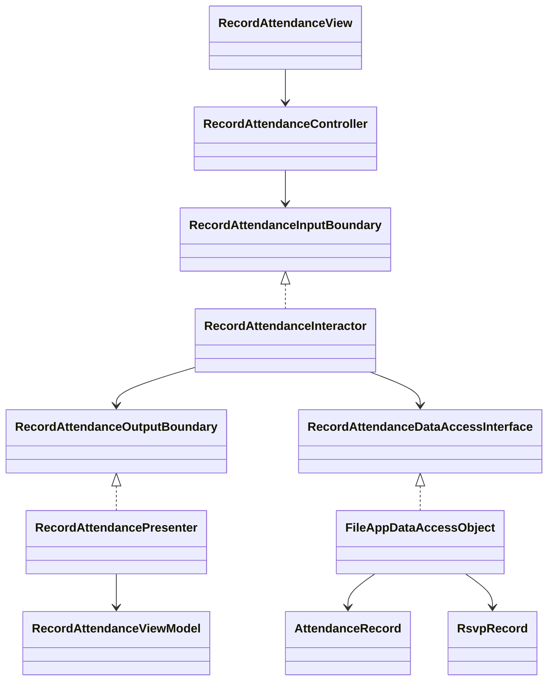
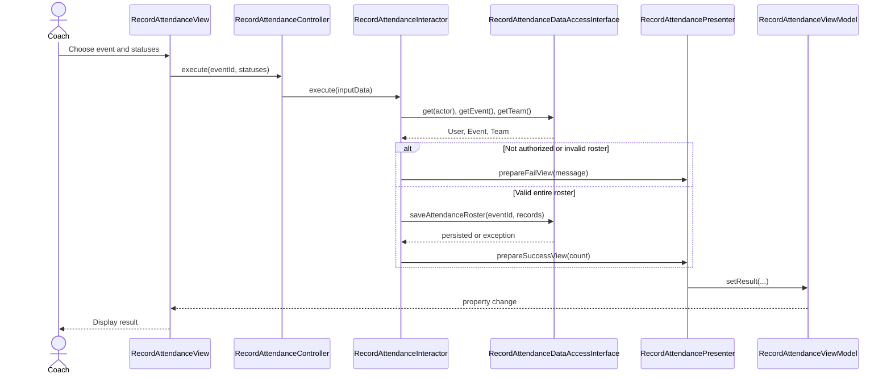

# The master documentation file containing our work as we work on the project (diagrams, sketches, prototypes)

## L2 — Attendance and player statistics (Aidan)

### Glossary

- **Attendance record:** The actual outcome of one player's participation in one event, recorded by the assigned coach. Allowed values are `PRESENT`, `ABSENT`, and `EXCUSED`.
- **RSVP:** A player's intention to attend a future event (`YES`, `NO`, or `MAYBE`). An RSVP is *not* an attendance record.
- **Roster:** The usernames of the players currently assigned to a team.
- **Attendance history:** Past event attendance records for the currently authenticated player.
- **Attendance rate:** Present / (Present + Absent); Excused does not contribute to the denominator. The team should ratify this policy if a different interpretation is expected.
- **Performance notes:** Optional free-text `statsNotes` attached to an attendance record. Structured per-sport statistics are contingent on decision D1.

### L2 class diagram (conceptual)

### L2 sequence diagram — record attendance

### CRC cards — L2

| Class | Responsibilities | Collaborators |
|---|---|---|
| `RecordAttendanceInteractor` | Validate role, event, team and roster; save complete attendance atomically | Current-user port, attendance DAO port, output boundary |
| `RsvpInteractor` | Check player membership, event timing and coach authorization; store or retrieve responses | Current-user port, RSVP DAO port, output boundary |
| `EditAttendanceInteractor` | Validate coach ownership and existing record; preserve notes while correcting status | Current-user port, edit DAO port, output boundary |
| `ViewAttendanceHistoryInteractor` | Retrieve only the authenticated player's history and sort it | Current-user port, history DAO port, output boundary |
| `ViewStatsInteractor` | Calculate counts and attendance rate for the authenticated player | Current-user port, stats DAO port, output boundary |
| `FileAppDataAccessObject` | Persist and retrieve attendance and RSVP data with rollback on write failure | JSON mapper, entity classes |

### Outstanding decision

Decision D1 is still not explicitly resolved in the uploaded project plan. This L2 implementation uses the existing free-text `statsNotes` for performance. The conditional `record_stats` use case (UC-C6) must not be marked complete unless the team selects structured statistics and approves its schema. Shared UI and DAO changes must be reconciled with the latest L1/L3/L4 branches before merge.
