# Documentation

How the project is built. Diagrams marked **owed** are the deliverables named in `Plan.md` (task 1.7). The existing L1 diagrams and wiring notes describe the PR #10 baseline. Section 8 records the L5 additions on `daniel/l5-completion` as of November 23, 2026.

## 1. What the app is

Team Sports is a desktop application (Java 17 + Swing) that keeps a sports team schedule, attendance, stats and team information in one place. Four roles share one interface, and each role sees only the pages it may use.

## 2. Architecture

Clean Architecture, one package per layer:

| Layer | Package | Holds | Depends on |
|---|---|---|---|
| Entity | `entity` | `User`, `Role`, `Team`, `Event`, `AttendanceRecord`, `UserFactory` | nothing |
| Use case | `use_case/<name>` | input/output boundaries and data, the interactor, and the slice data-access interface | entity |
| Interface adapter | `interface_adapter/<name>` | controller, presenter, view model | use_case, entity |
| Interface adapter (shared) | `interface_adapter` | `ViewManagerModel` (which page is showing), `Session` (who is signed in) | the `CurrentUserInterface` port |
| Data access | `data_access` | `FileAppDataAccessObject`, `EntityJsonMapper`, `InMemoryUserDataAccessObject`, `OpenMeteoWeatherGateway` | entity, use-case interfaces |
| View | `view` | `LoginView`, `SignupView`, `ChangePasswordView`, `AppShell`, `CalendarView`, `CreateEventView`, `ViewManager`, `BackgroundImage` | interface_adapter |
| App | `app` | `AppBuilder` (builds the engine), `Main` (states what the app has) | everything |

- **Layer and package diagram** - L1 (task 1.7), below
- **Entity model diagram and CRC cards** - owed by L4
- **Class diagram for attendance/stats** - owed by L2

### Layer and package diagram (L1)

With every real dependency drawn in, one diagram was too crowded to read, so it is split in two:

1. **Layers and the dependency rule.** Package level. Shows every dependency that crosses a layer boundary.
2. **Dependencies inside the outer layers.** Class level. Shows which views and adapters reach sideways to the shared `Session` and `ViewManagerModel`, the two presenters that reach into the login slice's view model, and where the announcements page couples to use case output data.

#### 1. Layers and the dependency rule

Solid arrows mean "uses" (imports) and dotted arrows mean "implements". Both are dependencies. Every arrow points inward. Arrows that skip a layer, or that reach use case output data from outside the presenter, are labelled. The two that couple the announcements page to `ViewAnnouncementsOutputData` are marked FLAGGED.

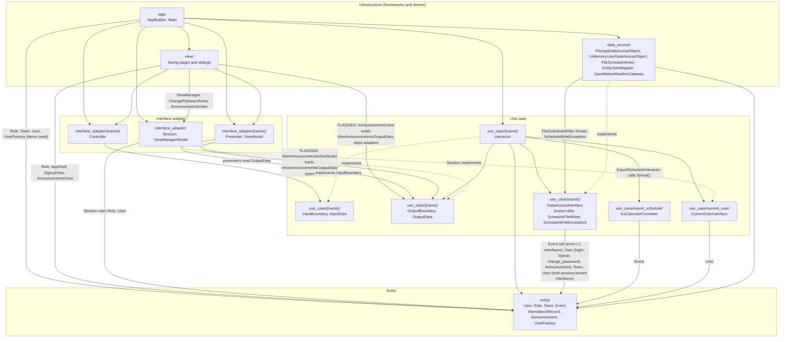

#### 2. Dependencies inside the outer layers

These arrows stay inside the outer two layers or point inward from them, so they do not break the dependency rule. They are drawn separately so diagram 1 stays readable.

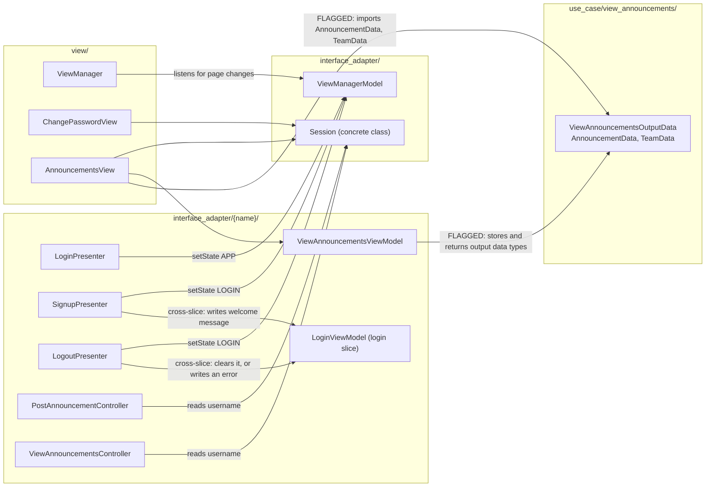

What the two diagrams show:

- **`use_case` has no outward arrows.** An interactor only knows its own boundaries, its own data-access interface, the `CurrentUserInterface` port and the entities. The data-access interfaces and the port also depend on entities (`Event` for every L1 interface, `User` for the port), which still points inward.
- **Data access is inverted.** Each interactor calls its slice's `...DataAccessInterface`, which lives in `use_case/<name>/`. `FileAppDataAccessObject` implements all of them, so the dependency runs from `data_access` into `use_case`, not the other way round. `FileScheduleWriter` does the same for the export slice's `ScheduleFileWriter`.
- **The boundaries are implemented across layers.** Every interactor implements its slice's `InputBoundary`, which the controller calls (it also reads the `InputData`). Interactors call `OutputBoundary` interfaces that presenters implement, and `CurrentUserInterface`, which `Session` implements. `OutputData` classes are not implemented by anything: interactors create them and presenters read them.
- **Views reach past the slice adapters in three ways.** `ViewManager` listens to `ViewManagerModel`. `ChangePasswordView` and `AnnouncementsView` take the concrete `Session`. `AppShell`, `SignupView` and `AnnouncementsView` import `entity.Role`. All of these point inward, so the rule holds, but they skip a layer.
- **The announcements page is coupled to use case output data (flagged).** The coupling starts in `ViewAnnouncementsViewModel` (L5), which stores and returns `ViewAnnouncementsOutputData.AnnouncementData` and `TeamData` instead of its own types. Because of that, `AnnouncementsView` imports those `use_case` classes too. They are the only view model and the only view that import anything from `use_case`. The other view models expose plain values or their own nested classes, such as `ViewScheduleViewModel.Entry`. Neither arrow breaks the inward rule, but the page now changes whenever the use case's output format does.
- **`data_access` also uses a use case class.** Besides implementing `ScheduleFileWriter`, `FileScheduleWriter` throws `ScheduleWriteException`, which is defined in `use_case/export_schedule`.
- **Some adapters use the shared state directly.** The login, signup and logout presenters set `ViewManagerModel` to change pages. `SignupPresenter` and `LogoutPresenter` also import `interface_adapter.login.LoginViewModel`, because both send the user back to the login page with a message or a cleared form. These are the only adapter-to-adapter dependencies between slices in the project; every other adapter imports only its own slice's classes plus the shared `Session` or `ViewManagerModel`. The two announcement controllers take the concrete `Session` and read the username themselves, instead of the interactor reading it through `CurrentUserInterface`.
- **`app` knows everything.** `AppBuilder` creates the concrete classes, passes them in through constructors, and uses `Role`, `Team`, `User` and `UserFactory` to seed the demo data.

### Package map

Every source package under `src/main/java`. Tests under `src/test/java` mirror the same package names.

| Package | Layer | Lane | What is in it |
|---|---|---|---|
| `entity` | Entity | L4 | `User`, `Role`, `Team`, `Event`, `AttendanceRecord`, `Announcement`, `UserFactory`. No imports from the rest of the project. |
| `use_case/current_user` | Use case | L3 | `CurrentUserInterface`, the "who is signed in" port that every interactor reads instead of asking the view. |
| `interface_adapter` | Interface adapter | L3 | `Session` (implements `CurrentUserInterface`) and `ViewManagerModel` (name of the page that should be showing). |
| `view` | Infrastructure | shared | Swing UI. L1: `CalendarView`, `CreateEventView`, `EventDetailsView` (modal dialog), `EventsListView`. L3: `LoginView`, `SignupView`, `ChangePasswordView`, `ViewManager`, `BackgroundImage`. L4: `AppShell`. L5: `AnnouncementsView`. |
| `data_access` | Infrastructure | shared | `FileAppDataAccessObject` (the JSON store, implements every slice's data-access interface), `EntityJsonMapper` (on-disk format), `InMemoryUserDataAccessObject` (test fake for the account slices), `FileScheduleWriter` (L1, writes the exported `.ics`), `OpenMeteoWeatherGateway` (L5, weather API). |
| `app` | Infrastructure | L1 | `AppBuilder` (creates and connects everything) and `Main` (lists the views and use cases, then shows the window). |

Each slice is a pair of packages with the same name:

| Slice | Lane | `use_case/<name>` | `interface_adapter/<name>` |
|---|---|---|---|
| `login` | L3 | Interactor, boundaries, input/output data, `LoginUserDataAccessInterface` | Controller, Presenter (navigates to the app), ViewModel |
| `signup` | L3 | Interactor, boundaries, input/output data, `SignupUserDataAccessInterface` | Controller, Presenter (navigates back to login), ViewModel |
| `logout` | L3 | Interactor, boundaries, output data. No input data and no data-access interface; it only clears `CurrentUserInterface` | Controller, Presenter (navigates to login). No view model |
| `change_password` | L3 | Interactor, boundaries, input/output data, `ChangePasswordUserDataAccessInterface` | Controller, Presenter, ViewModel |
| `create_event` | L1 | Interactor, boundaries, input/output data, `CreateEventDataAccessInterface` | Controller, Presenter, ViewModel |
| `view_schedule` | L1 | Interactor, boundaries, input/output data, `ViewScheduleDataAccessInterface` (read only) | Controller, Presenter, ViewModel |
| `view_event_details` | L1 | Interactor, boundaries, input/output data, `ViewEventDetailsDataAccessInterface` (read only) | Controller, Presenter, ViewModel |
| `edit_event` | L1 | Interactor, boundaries, input/output data, `EditEventDataAccessInterface` | Controller, Presenter, ViewModel |
| `cancel_event` | L1 | Interactor, boundaries, input/output data, `CancelEventDataAccessInterface` | Controller, Presenter, ViewModel |
| `browse_events` | L1 | Interactor, boundaries, input/output data, `BrowseEventsDataAccessInterface` (read only) | Controller, Presenter, ViewModel |
| `export_schedule` | L1 | Interactor, boundaries, input/output data, `ExportScheduleDataAccessInterface` (read), `ScheduleFileWriter` gateway (write), `ScheduleWriteException`, `IcsCalendarFormatter` | Controller, Presenter, ViewModel |
| `post_announcement` | L5 | Interactor, boundaries, input/output data, `PostAnnouncementDataAccessInterface` | Controller, Presenter, ViewModel |
| `view_announcements` | L5 | Interactor, boundaries, input/output data, `ViewAnnouncementsDataAccessInterface` | Controller, Presenter, ViewModel |

### AppBuilder wiring notes (L1)

`AppBuilder` creates the shared objects once, as fields: a single `FileAppDataAccessObject`, the `ViewManagerModel`, the `Session`, a `UserFactory` and the `ViewManager`. The current constructor seeds presentation data only when the store is genuinely empty. The PR #10 baseline used the earlier demo setup. `Main` then calls a chain of `add...` methods and finishes with `build()`.

**Where views are built.** Only three methods exist purely to build views: `addLoginView()`, `addSignupView()` and `addChangePasswordView()`. The other pages are built inside larger methods:

- `addAppShell()` builds the `AppShell`, `CalendarView` and `EventsListView`, plus placeholder panels for My Stats and Roster.
- `addViewEventDetailsUseCase()` builds the `EventDetailsView` panel. The panel is built once. Each call to `open()` creates a new modal `JDialog` around it and disposes that dialog when it closes.
- `addCreateEventUseCase()` builds `CreateEventView`, because that view takes its controller in its constructor.
- `addAnnouncementUseCases()` wires two use cases (`post_announcement` and `view_announcements`) and builds the `AnnouncementsView` that both of them share.

**How the L1 slices are assembled.** `addEditEventUseCase()` is a typical example. It creates the `EditEventViewModel`, a presenter that writes to that view model, an `EditEventInteractor` built from the shared `dataAccess`, the presenter and the `session`, and a controller around the interactor. Then it hands the controller and view model to a view that already exists (`eventDetailsView.setEditEventController(...)`). All seven L1 methods build view model, presenter, interactor and controller in that order. Each interactor receives the shared `FileAppDataAccessObject`, but its constructor only accepts that slice's interface, so it can only call what that interface declares. `session` is passed as a `CurrentUserInterface` in the same way. `addExportScheduleUseCase()` also passes a `new FileScheduleWriter()` as the second gateway.

**The other lanes' methods differ:**

- **`addLoginUseCase()`, `addSignupUseCase()`, `addLogoutUseCase()`** create no view model of their own. Their presenters take `viewManagerModel` plus view models built earlier (`loginViewModel`, `signupViewModel`).
- **Logout interactor:** gets no data-access object, only `session` and the presenter.
- **Signup interactor:** gets `dataAccess`, the presenter and the `userFactory`, but no session.
- **`addChangePasswordUseCase()`:** passes `dataAccess`, the presenter, `session` and `userFactory`.
- **`addAnnouncementUseCases()`:** passes the concrete `Session` to the two controllers rather than the port to the interactors. The controllers read the username and put it in the input data. Neither announcement interactor receives a session.

**Why the L1 slices each get their own method.** Each L1 method holds everything needed to build one slice, so the slice can be read, changed or removed in one place, and `Main` reads as a list of what the app has. Adding a feature means adding a method and a line in `Main` rather than editing a long shared block, which keeps merge conflicts between lanes small. The announcements method shows the alternative: two slices and a view built together.

**Navigation without depending on views.** `ViewManagerModel` only holds the name of the page that should be showing. A presenter that needs to change pages calls `setState(...)` and `firePropertyChanged()`. `ViewManager`, which is a view, listens and flips its `CardLayout`. The presenter depends only on the model in `interface_adapter` and never on a Swing class. In the current code only the login, signup and logout presenters do this; `AppBuilder`'s private `navigate()` helper uses the same mechanism for the "go to sign up" and "back to log in" links and for showing the login page in `build()`. None of the L1 presenters navigate. Their results show on the page or dialog that asked, so they only update a view model, and the view reacts to its property change.

**Ordering constraints.** These are real constraints in the code, not just conventions:

- **Views and the shell come first.** Use case methods read fields that earlier methods set, and when it fails depends on how the field is used.
  - **Crash at startup.** These fields are dereferenced as soon as the method runs, so a wrong order throws a `NullPointerException` while the app is being built:
    - `loginView` (`addLoginUseCase()`)
    - `signupView` (`addSignupUseCase()`)
    - `appShell` (`addLogoutUseCase()`, `addCreateEventUseCase()`, `addChangePasswordView()`, `addAnnouncementUseCases()`)
    - `changePasswordView` (`addChangePasswordUseCase()`)
    - `calendarView` (`addViewScheduleUseCase()`, `addViewEventDetailsUseCase()`, `addExportScheduleUseCase()`)
    - `eventsListView` (`addBrowseEventsUseCase()`)
    - `eventDetailsView` (`addEditEventUseCase()`, `addCancelEventUseCase()`)
  - **Crash later.** `addSignupUseCase()` and `addLogoutUseCase()` only pass `loginViewModel` into a presenter constructor, so a null there is stored without complaint. It fails later: at the first successful sign-up, when `SignupPresenter` writes the welcome message to it, and at the first logout attempt, when `LogoutPresenter` clears it or writes an error to it.
- **Sidebar order.** `AppShell` keeps its pages in a `LinkedHashMap`, so the sidebar shows pages in the order `addPage` was called, and `applyRole()` hides the ones the role may not see. `addAppShell()` adds the first four (Calendar, Events, My Stats, Roster), so those always lead. Pages added by later methods are appended in `Main`'s call order: New Event (`addCreateEventUseCase()`), Account (`addChangePasswordView()`), then Announcements. A coach currently sees Calendar, Events, Roster, New Event, Account, Announcements.
- **Edit, cancel and browse follow `addViewEventDetailsUseCase()`.** That method creates the one `EventDetailsView` panel and connects it to the calendar. `addEditEventUseCase()` and `addCancelEventUseCase()` call `eventDetailsView.set...Controller(...)` straight away, so they would fail with a `NullPointerException` if the panel did not exist yet. `addBrowseEventsUseCase()` only reads `eventDetailsView` inside its row-click callback, so it would not crash at startup, but the first click would fail if the panel were never created. It is kept after for the same reason, and so `Main` shows the dependency. What the three slices share is the panel and its controllers; the `JDialog` around it is new on every `open()`. The panel's close callback is always `calendarView::refresh`, so closing it reloads the calendar even when it was opened from the Events page. The Events page reloads itself separately once `open()` returns.
- **Announcements are last.** `addAnnouncementUseCases()` runs last in `Main`, so Announcements is the last item in the sidebar. Moving it up means moving that call earlier in `Main`.

## 3. Use cases

Every interaction a user can trigger is its own slice. The full catalogue (33 use cases with lane, sprint, priority and status) lives in `Plan.md`.

Built so far:

| Use case | Slice | View | Tests |
|---|---|---|---|
| `login` (UC-A1) | `use_case/login` + `interface_adapter/login` | `LoginView` | `LoginInteractorTest` (8) |
| `signup` (UC-A2) | `use_case/signup` + `interface_adapter/signup` | `SignupView` | `SignupInteractorTest` (8) |
| `logout` (UC-A3) | `use_case/logout` + `interface_adapter/logout` | Log out button in `AppShell` | `LogoutInteractorTest` (2) |
| `change_password` (UC-A4) | `use_case/change_password` + `interface_adapter/change_password` | `ChangePasswordView` (Account page) | `ChangePasswordInteractorTest` (8) |
| `create_event` (UC-B1) | `use_case/create_event` + `interface_adapter/create_event` | `CreateEventView` | `CreateEventInteractorTest`, supplied with PR #10 |

- **Sequence diagrams** - owed by each lane for its own use cases (task 3.8, coordinated by L5)

The account slices are the template the others copy: the view calls a controller, the controller builds input data, the interactor works through a narrow data-access interface and reports to a presenter, and the presenter updates a view model or asks the `ViewManagerModel` to change pages.

### Sequence diagrams: scheduling and events (L1)

One diagram per L1 use case, traced from the code. Shared conventions:

- Every interactor first asks `CurrentUserInterface` (the `Session`) who is signed in. If nobody is, it calls `prepareFailView` and stops. That check is shown once in full (in `edit_event`) and left out of the shorter diagrams.
- `FileAppDataAccessObject` is the only production implementation of every data-access interface. A `break` block means the interactor calls the presenter's fail view and returns.
- **Read-failure branches are left out.** Every L1 interactor wraps its store reads in `catch (IllegalStateException | UncheckedIOException ex)` and reports "Could not read ...". `export_schedule` caught only `IllegalStateException` until it was brought into line. These branches cannot be reached with `FileAppDataAccessObject`. It reads the file once, in its constructor, and after that every read method works on in-memory maps and never throws. Only the test fakes reach them.
- **Write failures and rollback.** `saveEvent` and `updateEvent` in `FileAppDataAccessObject` put the new event in the map, call `persist()`, and on any `RuntimeException` put the previous event back (or remove the new one) and rethrow. `persist()` reports a failed disk write as `UncheckedIOException`. The interactors catch `IllegalStateException | UncheckedIOException` around the write. Any other `RuntimeException` is still rolled back by the DAO, but it is not caught by the interactor, so it escapes `execute()` and no fail view appears.
- Every view model fires a property change when it is updated, and the view redraws from it.

#### edit_event (UC-B4)

Opened from the event details dialog. Only date/time, location and opponent can change; type and team cannot.

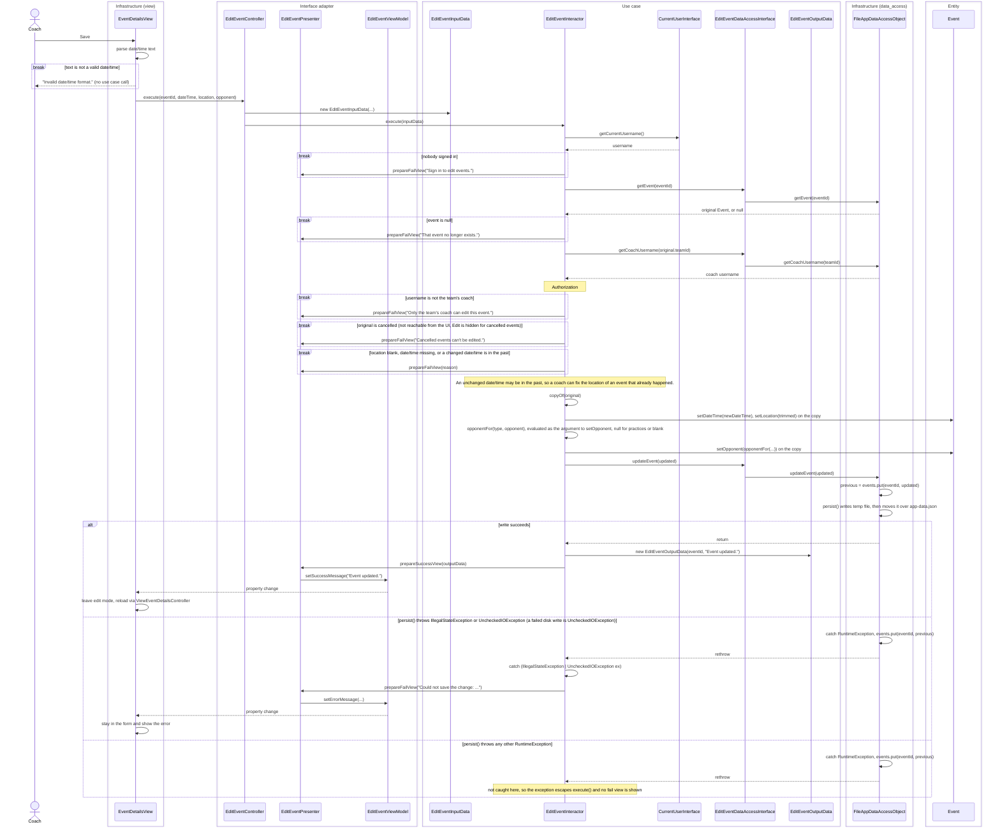

Because the interactor edits a copy and the DAO puts the previous event back when the write fails, the event in memory always matches what is on disk.

#### export_schedule (UC-B7)

Exports every dated event of the user's teams, past and future, cancelled ones included, as one `.ics` file. Events with no date are left out and counted. An iCalendar entry needs a start time, and inventing one would put the event on the wrong day, while failing the whole export would leave the user with nothing. Reading goes through the slice's data-access interface. Writing goes through a separate `ScheduleFileWriter` gateway. The `.ics` text is built by `IcsCalendarFormatter`, a package-private class in the use case layer that never touches the file system.

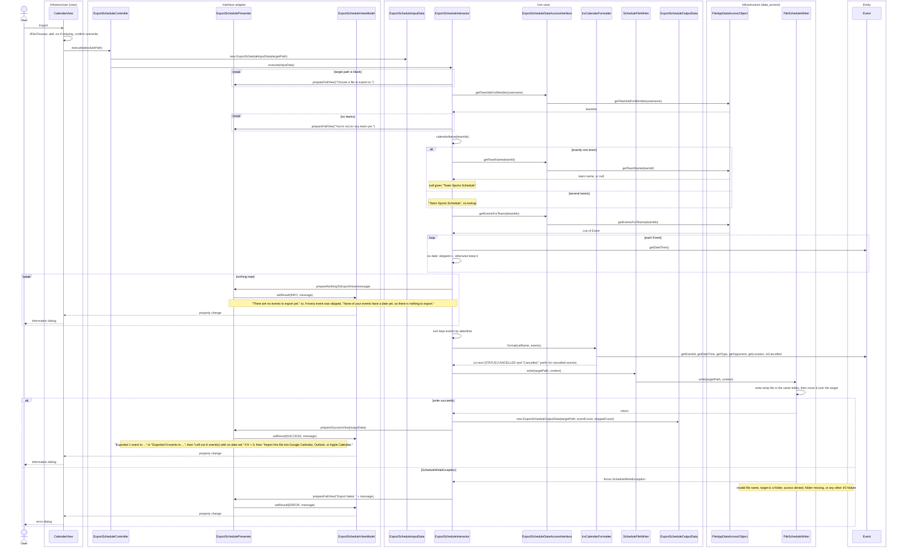

Every path that reaches the presenter ends the same way: the view model fires a property change and `CalendarView` shows a dialog. SUCCESS and INFO results get an information dialog, and ERROR results (including the fail views not drawn above) get an error dialog.

#### browse_events (UC-B5)

The Events page sends its two filter choices as input data. The interactor does all the filtering, so the view never holds events it should not show.

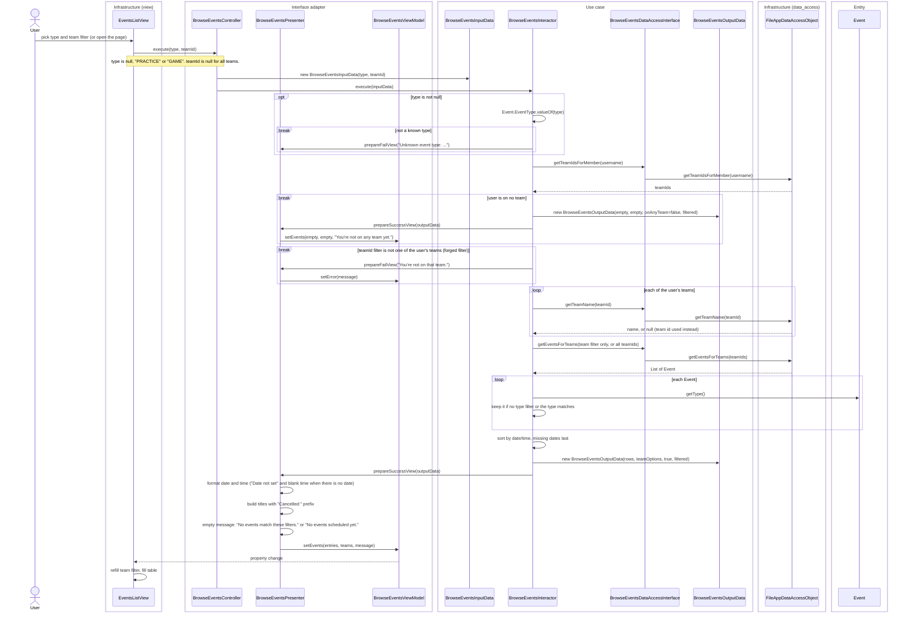

The team filter box is filled only from the user's own teams, so the forged-filter path is not reachable through the normal UI. It is checked in the interactor anyway, so that the rule does not depend on the view.

#### create_event (UC-B1)

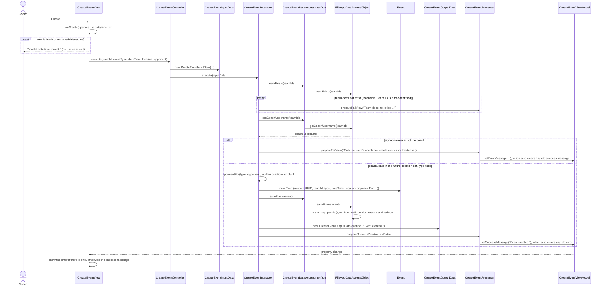

Other fail views:
- a past date/time: "Event date/time must be in the future."
- blank location: "Location is required."
- save failure: "Could not save the event: ..."

Not reachable from the UI (the interactor still checks them, and the tests reach them):
- a missing date/time. It gives the same "must be in the future" message, but `onCreate()` already rejects blank text before the controller is called.
- missing type ("Choose an event type.") and unknown type ("Unknown event type: ..."). `typeBox` is a fixed combo box holding only PRACTICE and GAME.
- "Could not read the team: ..." when `teamExists` or `getCoachUsername` throws. Only a test fake can do that.

#### view_schedule (UC-B2)

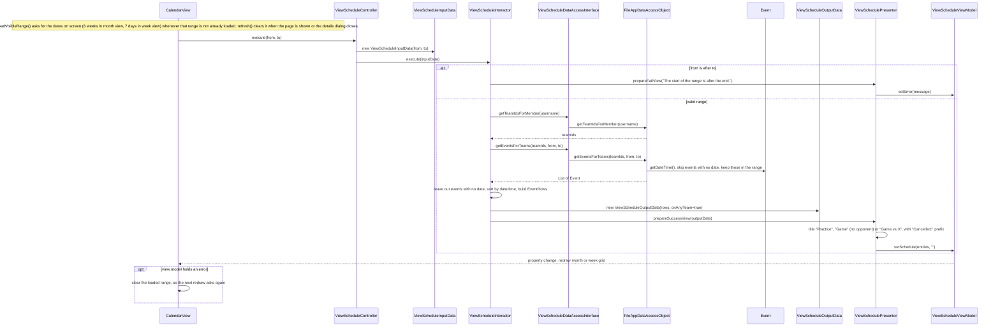

Other paths: a missing `from` or `to` gives "No date range was given." A user on no team gets a success view with no events, and the presenter shows "You're not on any team yet." The interactor also drops any event with no date, since the calendar has no cell for it. The JSON store already leaves those out of a date-range query, so this only matters for other implementations such as test fakes.

#### view_event_details (UC-B3)

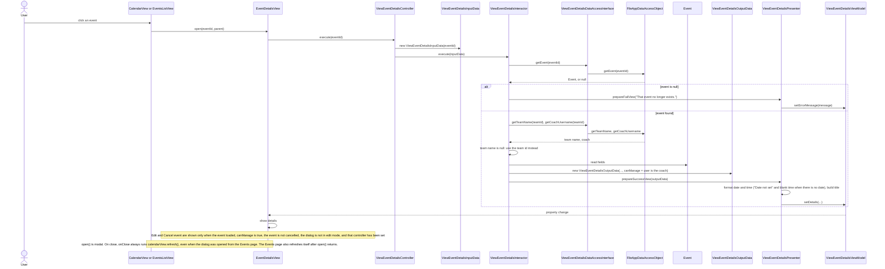

Other fail view: a blank event id ("No event was selected."). `canManage` only decides which buttons appear. `edit_event` and `cancel_event` check the coach again themselves.

#### cancel_event (UC-B6)

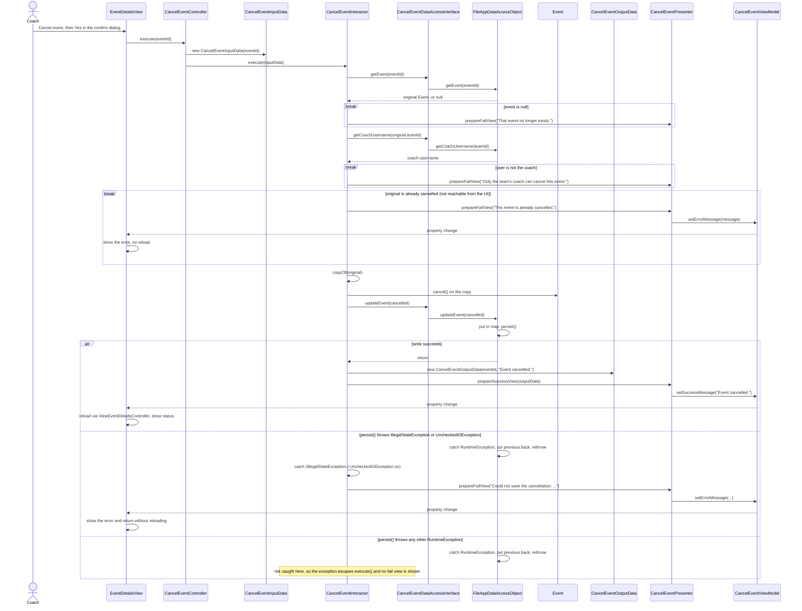

The already-cancelled branch cannot be reached from the UI, because the Cancel event button is hidden for cancelled events. The event is not deleted. It stays in the store flagged as cancelled, and the calendar, Events page and export all show it with a "Cancelled:" prefix. On any fail view the dialog shows the error and does not reload the event.

## 4. Storage

One local JSON file, `data/app-data.json` (git-ignored, created on first write), holds users, teams, events, attendance, announcements, event notifications, parent links, and absence notices. `EntityJsonMapper` is the single place the on-disk shape lives, so a hosted store can replace the file without touching any use case.

The signed-in user is deliberately not in the file: it lives in `Session`, behind the `use_case/current_user/CurrentUserInterface` port, so the interactors own the session transitions rather than the views.

**Security note:** passwords are stored in plaintext, matching course scope. This must be revisited before any real deployment.

## 5. How to build, test and run

```bash
./gradlew build
./gradlew test
./gradlew test -Pnetwork
./gradlew run
./gradlew seedDemo -PdemoData=data/demo-data.json
./gradlew run -PappData=data/demo-data.json
```

Use JDK 21 and the checked-in wrapper. The project targets Java 17 bytecode. Default tests exclude live-network checks. With dependencies cached, `./gradlew --offline build` runs the build without downloads. The seeder refuses an existing destination. A genuinely empty application store is seeded with the dataset described in section 10, and existing stores retain their data.

## 6. Known limitations

- Data is **per machine**: the JSON file is local, so nothing is shared between devices yet. A hosted store is a later one-class swap.
- Attendance, RSVP, stats, and roster management are maintained on the other lanes' branches and remain subject to integration and review.
- `manage_users` is not built yet, so roles are chosen at sign-up.
- One role per user (decision D5).
- City forecasts can differ from conditions at an exact venue. Events outside the 16-day window and missing provider values show unavailable weather.
- Parent relationships are currently admin-controlled. The original invite/accept design remains a separate L4 product choice.

## 7. API notes

Open-Meteo (no key required) is our external API. It was called successfully from Java on 2026-10-29 and is documented in the README API section in the course required format (link, how it is used, whether it was called). Alternatives we considered are listed in `Plan.md` decision D7.

## 8. Communication, parent access, and weather (L5)

All seven L5 use cases are implemented on `daniel/l5-completion`. This includes the previously merged announcement slices. Teammate approval remains a separate step. The minimal admin-controlled parent-link workflow is a dependency needed for the requested parent features, with shared ownership review still required from L4. The scheduling source and diagrams above arrived through the PR #10 merge.

### Architecture and ownership

| Package or class | Responsibility | Owner or dependency |
|---|---|---|
| `post_announcement`, `view_announcements` | Validate coach posting and read authorized team posts | Daniel, L5 |
| `view_notifications` | Filter durable event changes by current team membership or linked children | Daniel, L5 |
| `submit_absence_notice`, `view_absence_notices` | Validate advance absence reports and show the parent or coach an authorized history | Daniel, L5 |
| `link_parent_to_player` | Let an administrator approve or revoke a parent/player relationship | L4 dependency bridge for the requested L5 parent flows |
| `view_event_weather`, `flag_rain_risk` | Authorize forecasts, represent unavailable data, and compute the 60% rain threshold | Daniel, L5 |
| `EventWeatherGateway` | Use-case-owned contract for obtaining a daily forecast | Implemented by `OpenMeteoWeatherGateway` |
| `FileAppDataAccessObject`, `EntityJsonMapper` | Persist the shared schema and keep event changes in the same transaction as their notifications | Shared data layer |
| `AnnouncementsView`, `NotificationsView`, `AbsenceNoticesView`, `ParentLinksView`, `EventWeatherPanel`, `RainRiskPanel` | Forms, selectors, feedback, refresh, and session clearing | L5 UI with L1 page integration |

The new parent and notification interactors read identity through `CurrentUserInterface`. Announcement and weather controllers obtain the current identity from `Session`, and their interactors check current stored roles and membership. Page visibility helps navigation, while business logic enforces access. Failed loads clear previous private results. Session changes clear forms and cancel or invalidate outstanding weather requests.

The L5 view models currently expose immutable use-case output DTOs to the views. This follows the announcement implementation's existing coupling described in the L1 baseline. The additional parent and weather views share that characteristic, so the earlier statement that announcements are the only such view applies to the baseline snapshot.

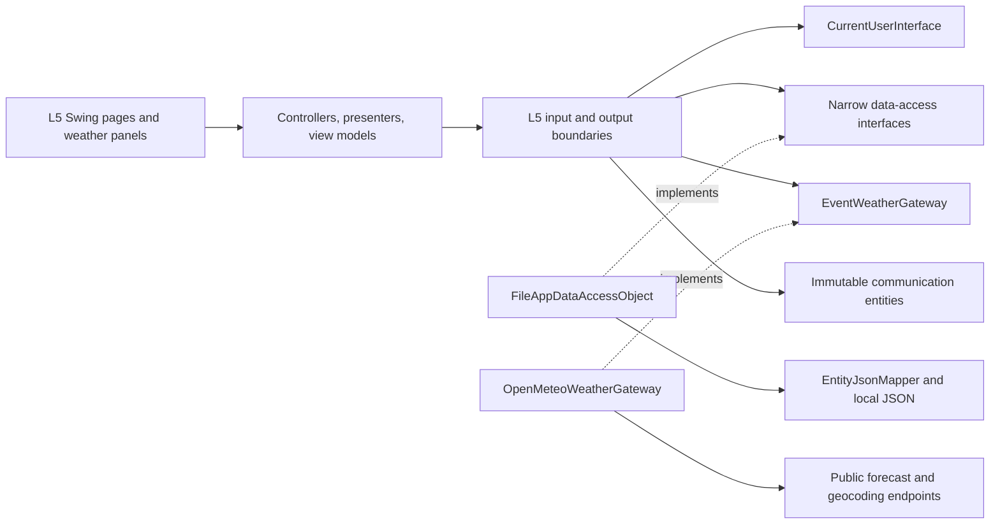

### Entities, schema, and CRC cards

The four communication entities are immutable. They reference existing users, teams, and events by stable identifiers. Role and membership checks belong to the use cases. An absence notice records advance intent, while the coach's attendance record remains a separate observation.

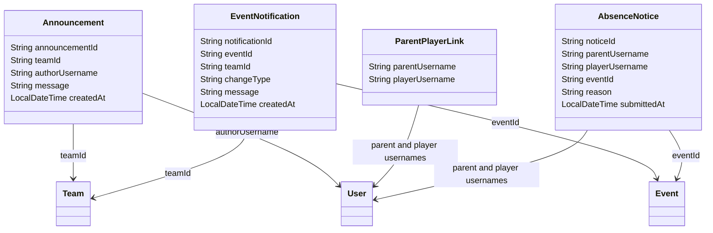

| Class | Responsibilities | Collaborators |
|---|---|---|
| `Announcement` | Keep one coach's team message, authorship, and posting time immutable | Posting/reading interactors, `Team`, `User`, JSON mapper |
| `EventNotification` | Preserve one created, changed, or cancelled event message and its original timestamp | Event persistence transaction, notification interactor, `Event`, `Team` |
| `ParentPlayerLink` | Identify one approved parent/player pair | Admin link interactor, parent authorization, `User` |
| `AbsenceNotice` | Keep a parent's reason for one child and event, including submission time | Submit/view absence interactors, `Event`, parent/player users |
| `PostAnnouncementInteractor` | Require a current coach assigned to the team and report success after saving | Posting data-access port and output boundary |
| `ViewNotificationsInteractor` | Recheck role, roster, and parent links before presenting event history | Current-user port, notification data-access port, presenter |
| `SubmitAbsenceNoticeInteractor` | Require a linked player on the event's roster and an upcoming active event | Current-user port, submission data-access port, `Clock` |
| `ViewAbsenceNoticesInteractor` | Provide linked-child/event options to parents and own-team notices to coaches | Reading data-access port, current-user port, presenter |
| `LinkParentToPlayerInteractor` | Restrict approval and removal to a stored administrator | User/link data-access port, current-user port |
| `ViewEventWeatherInteractor` | Authorize event weather before and after an external lookup | Event data-access port, weather gateway, output boundary |
| `FlagRainRiskInteractor` | Read upcoming authorized events and preserve unavailable or stale states | Rain-risk data-access port, weather gateway, presenter |

The top-level JSON collections added by L5 are shown below. Examples illustrate the field names rather than a complete seed file.

```json
{
  "announcements": [
    {"announcementId": "post-1", "teamId": "demo-team", "authorUsername": "coach1", "message": "Bring water.", "createdAt": "2026-11-23T12:00"}
  ],
  "eventNotifications": [
    {"notificationId": "change-1", "eventId": "demo-demo-team-1", "teamId": "demo-team", "changeType": "CREATED", "message": "Practice scheduled.", "createdAt": "2026-11-23T12:00"}
  ],
  "parentLinks": [
    {"parentUsername": "parent1", "playerUsername": "player1"}
  ],
  "absenceNotices": [
    {"noticeId": "notice-1", "parentUsername": "parent1", "playerUsername": "player1", "eventId": "demo-demo-team-1", "reason": "Medical appointment.", "submittedAt": "2026-11-23T12:00"}
  ]
}
```

Older stores load with empty missing collections. A present collection with an invalid type is rejected. Saves preserve unknown sections and record fields. The file is written to a temporary sibling and then replaced, using atomic replacement when supported. Event changes and their notifications share that write. A failed write restores the prior entries, and an unchanged event update produces no notification. Loading the notification feed performs no delivery or reconstruction, so refreshing cannot duplicate the persisted history.

An absence notice has a deterministic ID derived from parent, player, and event. Submitting again updates that same report with explicit feedback. An ID collision with a different identity is rejected. Parent links support multiple players per parent, and removing a link revokes the parent's access on the next authorization check. Previously submitted notices remain available to the event team's coach.

### Sequence diagrams

#### Post and view announcements (UC-E1 and UC-E2)

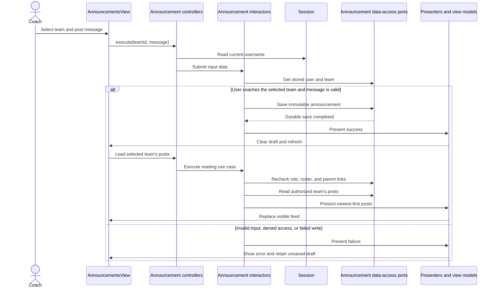

#### Event transaction and notification reading (UC-E3)

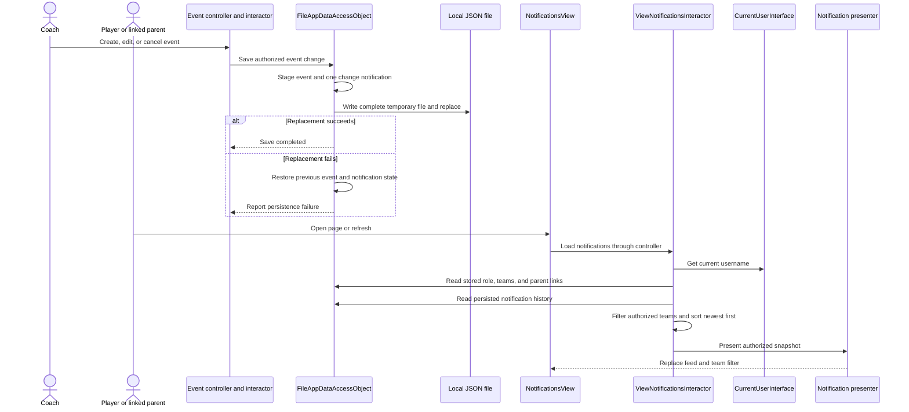

#### Administrator approves parent access (L4 dependency bridge)

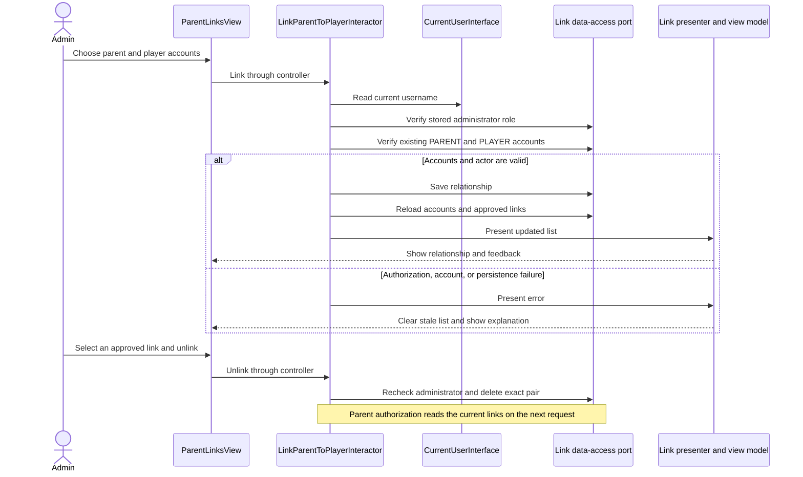

#### Submit an advance absence (UC-E4)

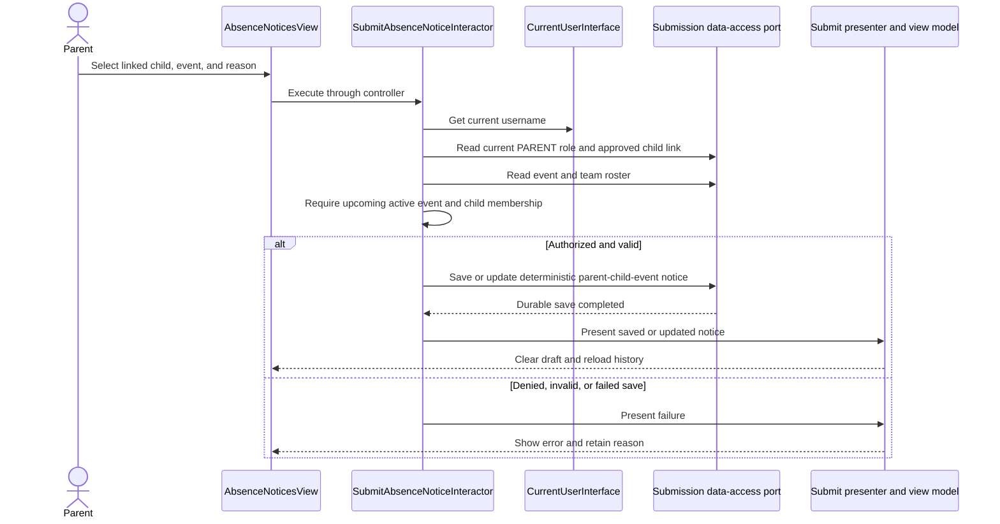

#### View parent or coach absence history (UC-E5)

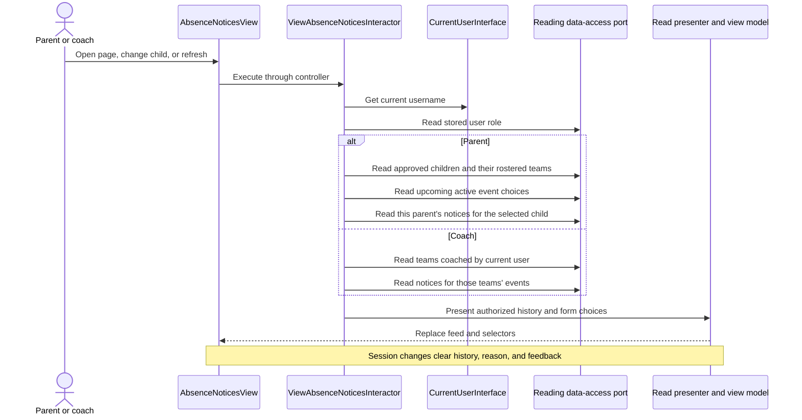

#### Event weather and upcoming rain flags (UC-F1 and UC-F2)

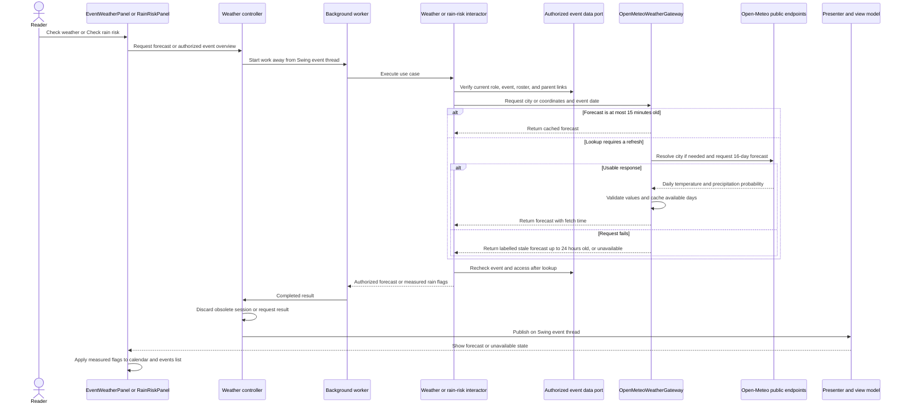

A probability of at least 60% produces a rain-risk flag. Missing numbers, out-of-range dates, and unresolved locations remain unavailable. The gateway's cache lasts for the current process, treats data as fresh for 15 minutes, and permits a labelled fallback up to 24 hours old after a failed lookup. Calendar and event-list flags are cleared or refreshed when event context or session changes. Both explicit check buttons use background work, and opening event details loads metadata without initiating a weather request.

## 9. Delivery and independent verification — November 23, 2026

### Integrated application checks

| Check | Result |
|---|---|
| `./gradlew --offline build installDist` | 291 tests, 0 failures. The installed application and distribution archives were built |
| `./gradlew --offline test -Pnetwork` | 292 tests, 0 failures, including the live Open-Meteo test |
| Live coordinate forecast for November 23 | Toronto high 10.0 °C, rain probability 20% |
| Actual event-weather panel for November 24 | Resolved Toronto, Ontario, Canada, high 2.7 °C, rain probability 1%, fetched at `2026-11-23T20:42:14Z` |
| Actual entry point and forms | `Main.configure` exercised the configured application, including linked-parent access, notice submission, event changes, and authorization boundaries |
| Screenshot inspection | Actual Swing pages captured and visually inspected at `docs/images/notifications.png`, `docs/images/absence-notices.png`, and `docs/images/weather.png` |

The live batch used three public requests in total, consisting of one coordinate forecast and a city geocoding/forecast pair through the actual event panel. It used the public educational, noncommercial service, incurred no service charge, and created no account, subscription, or recurring activity. Weather attribution appears in the interface as Open-Meteo, CC BY 4.0.

The offline suite includes regressions for two issues found during final integration. Successful create/edit/cancel flows cancel and clear obsolete rain-risk flags. Event mutations require the actor's current stored COACH role, so a former coach who is now a linked parent cannot retain event-management access. The suite also covers the configured application form flows, rollback, parent-link authorization, repeated absence updates, session clearing, and unavailable forecasts.

The installed package is `build/install/team-sports-platform`, with launcher `bin/team-sports-platform` (or `bin/team-sports-platform.bat` on Windows). Distribution archives are in `build/distributions`, including `team-sports-platform-0.1.0.zip`. The delivery branch remains `daniel/l5-completion` with owning-lane and non-author review pending.

### Other-lane verification

The following runs checked other lanes at their recorded branch heads. Both suites passed, and the additional reproductions found behavior outside their test coverage. The findings need the owning lanes' follow-up and teammate review.

| Lane and branch head | Suite result | Reproduced issue | Owner action |
|---|---|---|---|
| L2, `977b912` | 120 tests, 0 failures | `FileAppDataAccessObject.java:205–208` in that branch removes former roster players' event records during `saveAttendanceRoster`. A one-record history became empty after correcting the current roster and reopening the store | Aidan should preserve existing event attendance for players outside the current edited roster and add a regression covering removal from a team |
| L4, `d171e05` | 126 tests, 0 failures | `ViewRosterInteractor.java:53` throws for a team with no coach. `ManageRosterInteractor.java:52,59` and `AssignCoachInteractor.java:45` change the live `Team` before a failed persistence operation, so the running view changes while reopening restores the older roster | Aarav should handle an unassigned coach and stage team changes or restore them after a failed write, with tests comparing memory and reopened data |

The line references above identify those branch snapshots. Their source is separate from this branch's L5 implementation. The integrated application results above cover the current delivery branch. To repeat the offline check with cached dependencies, run `./gradlew --offline build installDist`. A live check is opt-in through `./gradlew --offline test -Pnetwork`.

## 10. Five-minute demo

Create a fresh demo file before the presentation. Use an unused destination, because the seeder refuses to replace a file. Reuse the resulting path when starting or restarting the app.

```bash
./gradlew seedDemo -PdemoData=data/demo-data.json
./gradlew run -PappData=data/demo-data.json
```

All accounts use password `pw`. The dataset has 15 accounts, three announcements, one example absence notice, eight parent/player relationships, and 42 upcoming events over the next 14 days. Event IDs follow `demo-<teamId>-<day>`, where day 1 is tomorrow relative to seeding.

| Team | Coach | Players | City and first event |
|---|---|---|---|
| Toronto Hawks (`demo-team`) | `coach1` | `player1`–`player3` | Toronto, Ontario, `demo-demo-team-1` at 18:00 tomorrow |
| Ottawa Bears (`north-team`) | `coach2` | `player4`–`player6` | Ottawa, Ontario, `demo-north-team-1` at 19:00 tomorrow |
| Hamilton Falcons (`south-team`) | `coach1` | `player7`–`player8` | Hamilton, Ontario, `demo-south-team-1` at 20:00 tomorrow |

The links pair `parent1` with `player1`/`player2`, `parent2` with `player3`/`player4`, `parent3` with `player5`/`player6`, and `parent4` with `player7`/`player8`. `admin1` manages links. The example absence is from `parent1` for `player1` at `demo-demo-team-2`.

| Time | Actions | Visible result |
|---|---|---|
| 0:00–0:35 | Sign in as `admin1`, open Parent links, select `parent1`/`player2`, unlink and link that pair again | The approved links list returns to eight relationships, demonstrating administrator control |
| 0:35–1:25 | Sign in as `coach1`. Post “Bring indoor shoes and water” to Toronto Hawks. Open tomorrow's first Toronto event and change its time from 18:00 to 18:30 | The new team announcement appears and the event update saves |
| 1:25–2:15 | Sign in as `parent1`. Open Announcements and Notifications. In Absence notices choose `player1` and that first event, submit “Medical appointment”, then resubmit “Medical appointment confirmed” | The parent sees the team's post and change history. One notice displays the updated reason |
| 2:15–2:50 | Sign in as `coach1` and open Absence notices | The feed identifies the parent, child, event, submission time, and updated reason for the coach's team |
| 2:50–3:25 | Sign in as `player1`, open Calendar, Announcements, and Notifications | Only the player's team data appears, with the updated event time and new post |
| 3:25–4:25 | Open the first Toronto event, press Check weather, then open Weather and press Check rain risk | A forecast, a labelled cached result, or an explicit unavailable state appears. Measured flags are reflected in Calendar and Events. City or coordinates can correct an ambiguous venue |
| 4:25–5:00 | Restart using the same demo path and sign in as `parent1` | The updated notice, post, event time, and persisted change history survive reopening |

For the weather step, use a network connection and an event within the 16-day window. A failed lookup may show a labelled stale forecast if the process has a usable cached result. Otherwise show the unavailable message and continue the local communication flow. The API panel credits Open-Meteo under CC BY 4.0. Avoid reseeding the presentation file between steps, since the demo is intended to show persistence.
