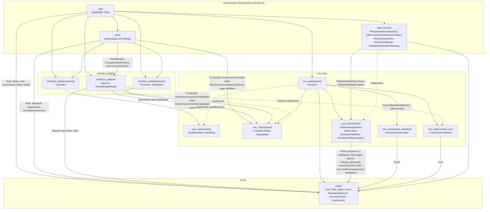
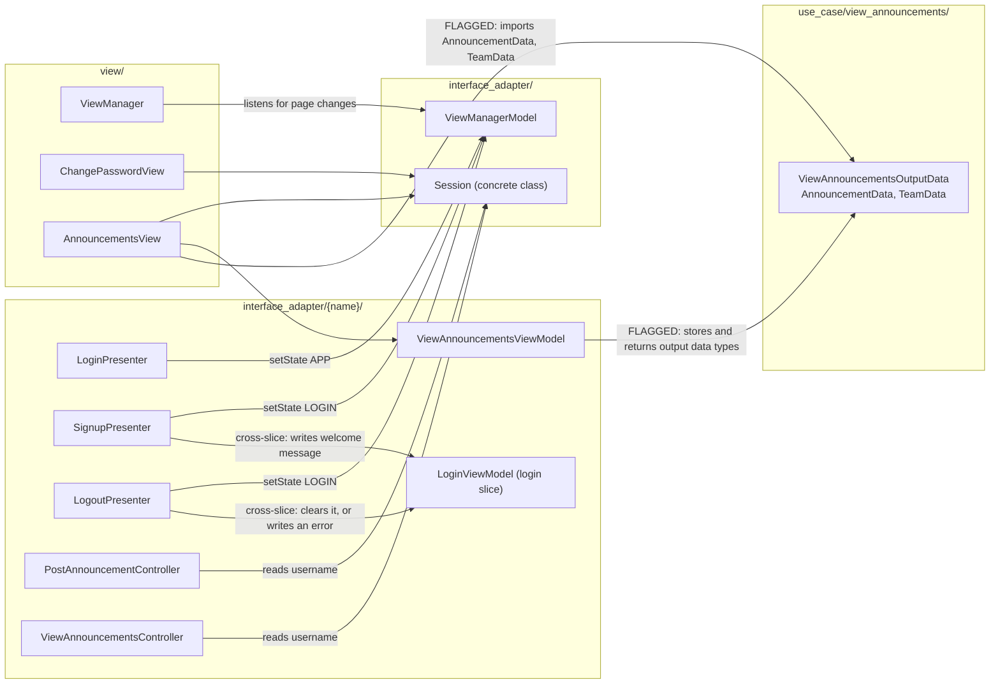
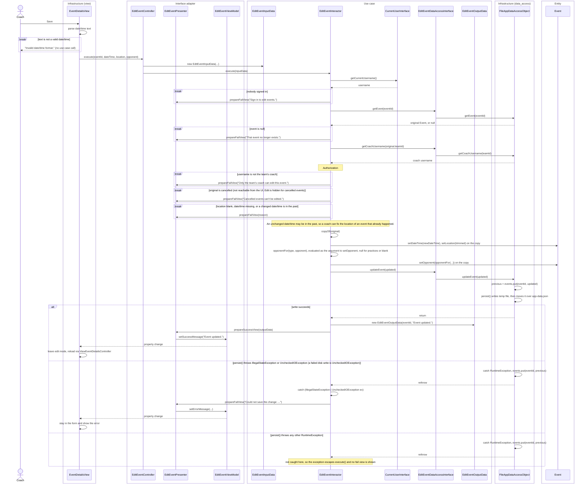
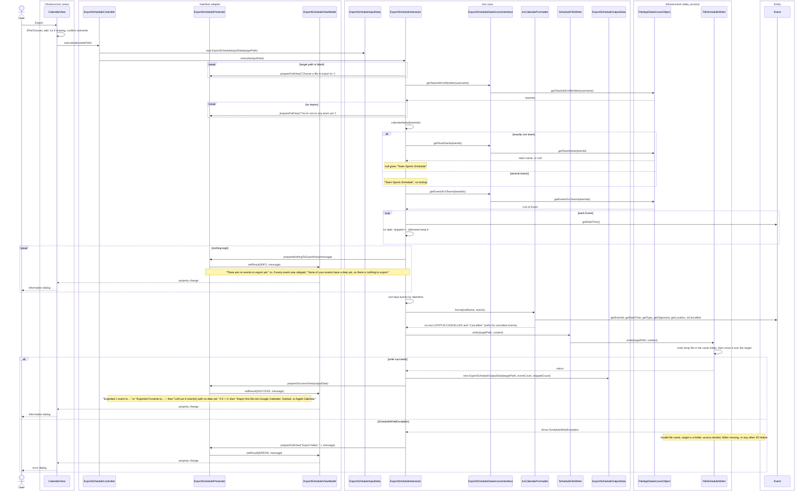
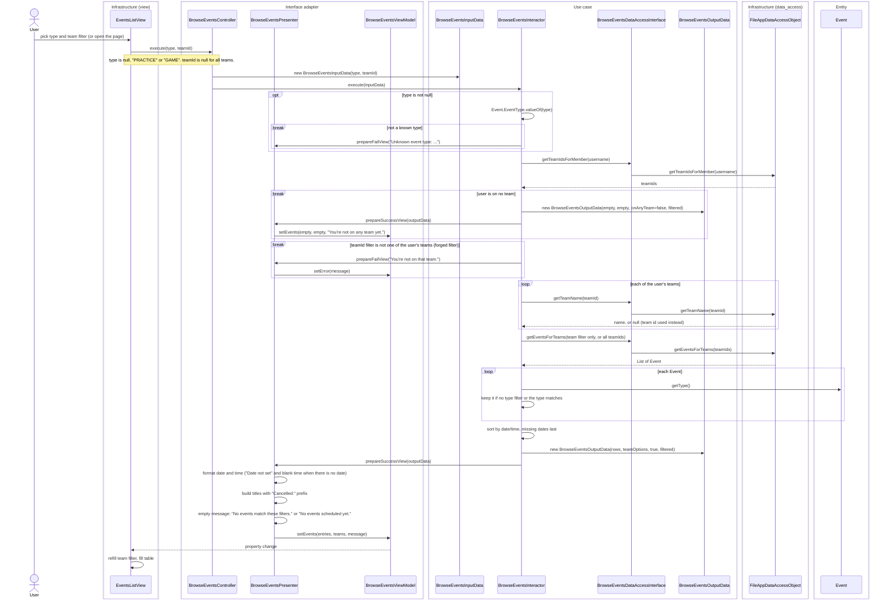
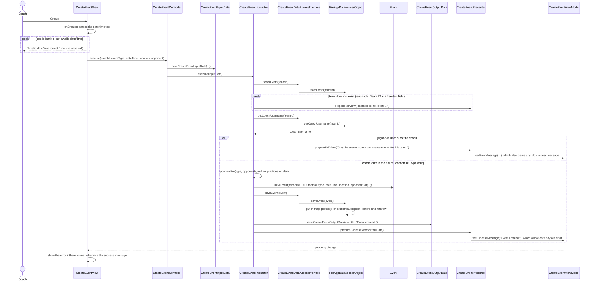
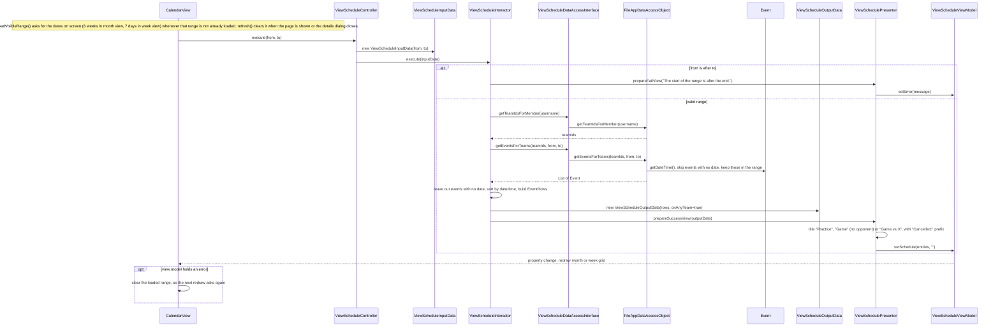
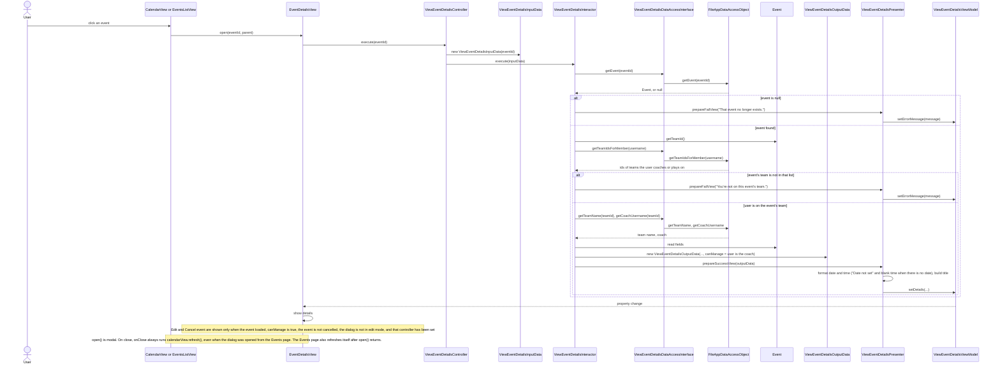
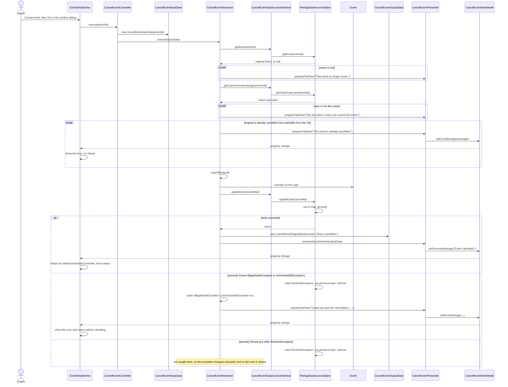

# Documentation

How the project is built. Diagrams marked **owed** are the deliverables named in `Plan.md` (task 1.7).

## 1. What the app is

Team Sports is a desktop application (Java 17 + Swing) that keeps a sports team schedule, attendance, stats and team information in one place. Four roles share one interface, and each role sees only the pages it may use.

## 2. Architecture

Clean Architecture, one package per layer:

| Layer | Package | Holds | Depends on |
|---|---|---|---|
| Entity | `entity` | `User`, `Role`, `Team`, `Event`, `AttendanceRecord`, `UserFactory` | nothing |
| Use case | `use_case/<name>` | input/output boundaries and data, the interactor, and the slice data-access interface | entity |
| Interface adapter | `interface_adapter/<name>` | controller, presenter, view model | use_case, entity |
| Interface adapter (shared) | `interface_adapter` | `ViewManagerModel` (which page is showing), `Session` (who is signed in) | the `CurrentUserInterface` port |
| Data access | `data_access` | `FileAppDataAccessObject`, `EntityJsonMapper`, `InMemoryUserDataAccessObject`, `OpenMeteoWeatherGateway` | entity, use-case interfaces |
| View | `view` | `LoginView`, `SignupView`, `ChangePasswordView`, `AppShell`, `CalendarView`, `CreateEventView`, `ViewManager`, `BackgroundImage` | interface_adapter |
| App | `app` | `AppBuilder` (builds the engine), `Main` (states what the app has) | everything |

- **Layer and package diagram** - L1 (task 1.7), below
- **Entity model diagram and CRC cards** - owed by L4
- **Class diagram for attendance/stats** - owed by L2

### Layer and package diagram (L1)

With every real dependency drawn in, one diagram was too crowded to read, so it is split in two:

1. **Layers and the dependency rule.** Package level. Shows every dependency that crosses a layer boundary.
2. **Dependencies inside the outer layers.** Class level. Shows which views and adapters reach sideways to the shared `Session` and `ViewManagerModel`, the two presenters that reach into the login slice's view model, and where the announcements page couples to use case output data.

#### 1. Layers and the dependency rule

Solid arrows mean "uses" (imports) and dotted arrows mean "implements". Both are dependencies. Every arrow points inward. Arrows that skip a layer, or that reach use case output data from outside the presenter, are labelled. The two that couple the announcements page to `ViewAnnouncementsOutputData` are marked FLAGGED.



#### 2. Dependencies inside the outer layers

These arrows stay inside the outer two layers or point inward from them, so they do not break the dependency rule. They are drawn separately so diagram 1 stays readable.



What the two diagrams show:

- **`use_case` has no outward arrows.** An interactor only knows its own boundaries, its own data-access interface, the `CurrentUserInterface` port and the entities. The data-access interfaces and the port also depend on entities (`Event` for every L1 interface, `User` for the port), which still points inward.
- **Data access is inverted.** Each interactor calls its slice's `...DataAccessInterface`, which lives in `use_case/<name>/`. `FileAppDataAccessObject` implements all of them, so the dependency runs from `data_access` into `use_case`, not the other way round. `FileScheduleWriter` does the same for the export slice's `ScheduleFileWriter`.
- **The boundaries are implemented across layers.** Every interactor implements its slice's `InputBoundary`, which the controller calls (it also reads the `InputData`). Interactors call `OutputBoundary` interfaces that presenters implement, and `CurrentUserInterface`, which `Session` implements. `OutputData` classes are not implemented by anything: interactors create them and presenters read them.
- **Views reach past the slice adapters in three ways.** `ViewManager` listens to `ViewManagerModel`. `ChangePasswordView` and `AnnouncementsView` take the concrete `Session`. `AppShell`, `SignupView` and `AnnouncementsView` import `entity.Role`. All of these point inward, so the rule holds, but they skip a layer.
- **The announcements page is coupled to use case output data (flagged).** The coupling starts in `ViewAnnouncementsViewModel` (L5), which stores and returns `ViewAnnouncementsOutputData.AnnouncementData` and `TeamData` instead of its own types. Because of that, `AnnouncementsView` imports those `use_case` classes too. They are the only view model and the only view that import anything from `use_case`. The other view models expose plain values or their own nested classes, such as `ViewScheduleViewModel.Entry`. Neither arrow breaks the inward rule, but the page now changes whenever the use case's output format does.
- **`data_access` also uses a use case class.** Besides implementing `ScheduleFileWriter`, `FileScheduleWriter` throws `ScheduleWriteException`, which is defined in `use_case/export_schedule`.
- **Some adapters use the shared state directly.** The login, signup and logout presenters set `ViewManagerModel` to change pages. `SignupPresenter` and `LogoutPresenter` also import `interface_adapter.login.LoginViewModel`, because both send the user back to the login page with a message or a cleared form. These are the only adapter-to-adapter dependencies between slices in the project; every other adapter imports only its own slice's classes plus the shared `Session` or `ViewManagerModel`. The two announcement controllers take the concrete `Session` and read the username themselves, instead of the interactor reading it through `CurrentUserInterface`.
- **`app` knows everything.** `AppBuilder` creates the concrete classes, passes them in through constructors, and uses `Role`, `Team`, `User` and `UserFactory` to seed the demo data.

### Package map

Every source package under `src/main/java`. Tests under `src/test/java` mirror the same package names.

| Package | Layer | Lane | What is in it |
|---|---|---|---|
| `entity` | Entity | L4 | `User`, `Role`, `Team`, `Event`, `AttendanceRecord`, `Announcement`, `UserFactory`. No imports from the rest of the project. |
| `use_case/current_user` | Use case | L3 | `CurrentUserInterface`, the "who is signed in" port that every interactor reads instead of asking the view. |
| `interface_adapter` | Interface adapter | L3 | `Session` (implements `CurrentUserInterface`) and `ViewManagerModel` (name of the page that should be showing). |
| `view` | Infrastructure | shared | Swing UI. L1: `CalendarView`, `CreateEventView`, `EventDetailsView` (modal dialog), `EventsListView`. L3: `LoginView`, `SignupView`, `ChangePasswordView`, `ViewManager`, `BackgroundImage`. L4: `AppShell`. L5: `AnnouncementsView`. |
| `data_access` | Infrastructure | shared | `FileAppDataAccessObject` (the JSON store, implements every slice's data-access interface), `EntityJsonMapper` (on-disk format), `InMemoryUserDataAccessObject` (test fake for the account slices), `FileScheduleWriter` (L1, writes the exported `.ics`), `OpenMeteoWeatherGateway` (L5, weather API). |
| `app` | Infrastructure | L1 | `AppBuilder` (creates and connects everything) and `Main` (lists the views and use cases, then shows the window). |

Each slice is a pair of packages with the same name:

| Slice | Lane | `use_case/<name>` | `interface_adapter/<name>` |
|---|---|---|---|
| `login` | L3 | Interactor, boundaries, input/output data, `LoginUserDataAccessInterface` | Controller, Presenter (navigates to the app), ViewModel |
| `signup` | L3 | Interactor, boundaries, input/output data, `SignupUserDataAccessInterface` | Controller, Presenter (navigates back to login), ViewModel |
| `logout` | L3 | Interactor, boundaries, output data. No input data and no data-access interface; it only clears `CurrentUserInterface` | Controller, Presenter (navigates to login). No view model |
| `change_password` | L3 | Interactor, boundaries, input/output data, `ChangePasswordUserDataAccessInterface` | Controller, Presenter, ViewModel |
| `create_event` | L1 | Interactor, boundaries, input/output data, `CreateEventDataAccessInterface` | Controller, Presenter, ViewModel |
| `view_schedule` | L1 | Interactor, boundaries, input/output data, `ViewScheduleDataAccessInterface` (read only) | Controller, Presenter, ViewModel |
| `view_event_details` | L1 | Interactor, boundaries, input/output data, `ViewEventDetailsDataAccessInterface` (read only) | Controller, Presenter, ViewModel |
| `edit_event` | L1 | Interactor, boundaries, input/output data, `EditEventDataAccessInterface` | Controller, Presenter, ViewModel |
| `cancel_event` | L1 | Interactor, boundaries, input/output data, `CancelEventDataAccessInterface` | Controller, Presenter, ViewModel |
| `browse_events` | L1 | Interactor, boundaries, input/output data, `BrowseEventsDataAccessInterface` (read only) | Controller, Presenter, ViewModel |
| `export_schedule` | L1 | Interactor, boundaries, input/output data, `ExportScheduleDataAccessInterface` (read), `ScheduleFileWriter` gateway (write), `ScheduleWriteException`, `IcsCalendarFormatter` | Controller, Presenter, ViewModel |
| `post_announcement` | L5 | Interactor, boundaries, input/output data, `PostAnnouncementDataAccessInterface` | Controller, Presenter, ViewModel |
| `view_announcements` | L5 | Interactor, boundaries, input/output data, `ViewAnnouncementsDataAccessInterface` | Controller, Presenter, ViewModel |

### AppBuilder wiring notes (L1)

`AppBuilder` creates the shared objects once, as fields: a single `FileAppDataAccessObject`, the `ViewManagerModel`, the `Session`, a `UserFactory` and the `ViewManager`. Its constructor also seeds the demo accounts and team if `coach1` is missing. `Main` then calls a chain of `add...` methods and finishes with `build()`.

**Where views are built.** Only three methods exist purely to build views: `addLoginView()`, `addSignupView()` and `addChangePasswordView()`. The other pages are built inside larger methods:

- `addAppShell()` builds the `AppShell`, `CalendarView` and `EventsListView`, plus placeholder panels for My Stats and Roster.
- `addViewEventDetailsUseCase()` builds the `EventDetailsView` panel. The panel is built once. Each call to `open()` creates a new modal `JDialog` around it and disposes that dialog when it closes.
- `addCreateEventUseCase()` builds `CreateEventView`, because that view takes its controller in its constructor.
- `addAnnouncementUseCases()` wires two use cases (`post_announcement` and `view_announcements`) and builds the `AnnouncementsView` that both of them share.

**How the L1 slices are assembled.** `addEditEventUseCase()` is a typical example. It creates the `EditEventViewModel`, a presenter that writes to that view model, an `EditEventInteractor` built from the shared `dataAccess`, the presenter and the `session`, and a controller around the interactor. Then it hands the controller and view model to a view that already exists (`eventDetailsView.setEditEventController(...)`). All seven L1 methods build view model, presenter, interactor and controller in that order. Each interactor receives the shared `FileAppDataAccessObject`, but its constructor only accepts that slice's interface, so it can only call what that interface declares. `session` is passed as a `CurrentUserInterface` in the same way. `addExportScheduleUseCase()` also passes a `new FileScheduleWriter()` as the second gateway.

**The other lanes' methods differ:**

- **`addLoginUseCase()`, `addSignupUseCase()`, `addLogoutUseCase()`** create no view model of their own. Their presenters take `viewManagerModel` plus view models built earlier (`loginViewModel`, `signupViewModel`).
- **Logout interactor:** gets no data-access object, only `session` and the presenter.
- **Signup interactor:** gets `dataAccess`, the presenter and the `userFactory`, but no session.
- **`addChangePasswordUseCase()`:** passes `dataAccess`, the presenter, `session` and `userFactory`.
- **`addAnnouncementUseCases()`:** passes the concrete `Session` to the two controllers rather than the port to the interactors. The controllers read the username and put it in the input data. Neither announcement interactor receives a session.

**Why the L1 slices each get their own method.** Each L1 method holds everything needed to build one slice, so the slice can be read, changed or removed in one place, and `Main` reads as a list of what the app has. Adding a feature means adding a method and a line in `Main` rather than editing a long shared block, which keeps merge conflicts between lanes small. The announcements method shows the alternative: two slices and a view built together.

**Navigation without depending on views.** `ViewManagerModel` only holds the name of the page that should be showing. A presenter that needs to change pages calls `setState(...)` and `firePropertyChanged()`. `ViewManager`, which is a view, listens and flips its `CardLayout`. The presenter depends only on the model in `interface_adapter` and never on a Swing class. In the current code only the login, signup and logout presenters do this; `AppBuilder`'s private `navigate()` helper uses the same mechanism for the "go to sign up" and "back to log in" links and for showing the login page in `build()`. None of the L1 presenters navigate. Their results show on the page or dialog that asked, so they only update a view model, and the view reacts to its property change.

**Ordering constraints.** These are real constraints in the code, not just conventions:

- **Views and the shell come first.** Use case methods read fields that earlier methods set, and when it fails depends on how the field is used.
  - **Crash at startup.** These fields are dereferenced as soon as the method runs, so a wrong order throws a `NullPointerException` while the app is being built:
    - `loginView` (`addLoginUseCase()`)
    - `signupView` (`addSignupUseCase()`)
    - `appShell` (`addLogoutUseCase()`, `addCreateEventUseCase()`, `addChangePasswordView()`, `addAnnouncementUseCases()`)
    - `changePasswordView` (`addChangePasswordUseCase()`)
    - `calendarView` (`addViewScheduleUseCase()`, `addViewEventDetailsUseCase()`, `addExportScheduleUseCase()`)
    - `eventsListView` (`addBrowseEventsUseCase()`)
    - `eventDetailsView` (`addEditEventUseCase()`, `addCancelEventUseCase()`)
  - **Crash later.** `addSignupUseCase()` and `addLogoutUseCase()` only pass `loginViewModel` into a presenter constructor, so a null there is stored without complaint. It fails later: at the first successful sign-up, when `SignupPresenter` writes the welcome message to it, and at the first logout attempt, when `LogoutPresenter` clears it or writes an error to it.
- **Sidebar order.** `AppShell` keeps its pages in a `LinkedHashMap`, so the sidebar shows pages in the order `addPage` was called, and `applyRole()` hides the ones the role may not see. `addAppShell()` adds the first four (Calendar, Events, My Stats, Roster), so those always lead. Pages added by later methods are appended in `Main`'s call order: New Event (`addCreateEventUseCase()`), Account (`addChangePasswordView()`), then Announcements. A coach currently sees Calendar, Events, Roster, New Event, Account, Announcements.
- **Edit, cancel and browse follow `addViewEventDetailsUseCase()`.** That method creates the one `EventDetailsView` panel and connects it to the calendar. `addEditEventUseCase()` and `addCancelEventUseCase()` call `eventDetailsView.set...Controller(...)` straight away, so they would fail with a `NullPointerException` if the panel did not exist yet. `addBrowseEventsUseCase()` only reads `eventDetailsView` inside its row-click callback, so it would not crash at startup, but the first click would fail if the panel were never created. It is kept after for the same reason, and so `Main` shows the dependency. What the three slices share is the panel and its controllers; the `JDialog` around it is new on every `open()`. The panel's close callback is always `calendarView::refresh`, so closing it reloads the calendar even when it was opened from the Events page. The Events page reloads itself separately once `open()` returns.
- **Announcements are last.** `addAnnouncementUseCases()` runs last in `Main`, so Announcements is the last item in the sidebar. Moving it up means moving that call earlier in `Main`.

## 3. Use cases

Every interaction a user can trigger is its own slice. The full catalogue (33 use cases with lane, sprint, priority and status) lives in `Plan.md`.

Built so far:

| Use case | Slice | View | Tests |
|---|---|---|---|
| `login` (UC-A1) | `use_case/login` + `interface_adapter/login` | `LoginView` | `LoginInteractorTest` (8) |
| `signup` (UC-A2) | `use_case/signup` + `interface_adapter/signup` | `SignupView` | `SignupInteractorTest` (8) |
| `logout` (UC-A3) | `use_case/logout` + `interface_adapter/logout` | Log out button in `AppShell` | `LogoutInteractorTest` (2) |
| `change_password` (UC-A4) | `use_case/change_password` + `interface_adapter/change_password` | `ChangePasswordView` (Account page) | `ChangePasswordInteractorTest` (8) |
| `create_event` (UC-B1) | `use_case/create_event` + `interface_adapter/create_event` | `CreateEventView` | owed by L2 (task 1.8) |

- **Sequence diagrams** - owed by each lane for its own use cases (task 3.8, coordinated by L5)

The account slices are the template the others copy: the view calls a controller, the controller builds input data, the interactor works through a narrow data-access interface and reports to a presenter, and the presenter updates a view model or asks the `ViewManagerModel` to change pages.

### Sequence diagrams: scheduling and events (L1)

One diagram per L1 use case, traced from the code. Shared conventions:

- Every interactor first asks `CurrentUserInterface` (the `Session`) who is signed in. If nobody is, it calls `prepareFailView` and stops. That check is shown once in full (in `edit_event`) and left out of the shorter diagrams.
- `FileAppDataAccessObject` is the only production implementation of every data-access interface. A `break` block means the interactor calls the presenter's fail view and returns.
- **Read-failure branches are left out.** Every L1 interactor wraps its store reads in `catch (IllegalStateException | UncheckedIOException ex)` and reports "Could not read ...". `export_schedule` caught only `IllegalStateException` until it was brought into line. These branches cannot be reached with `FileAppDataAccessObject`. It reads the file once, in its constructor, and after that every read method works on in-memory maps and never throws. Only the test fakes reach them.
- **Write failures and rollback.** `saveEvent` and `updateEvent` in `FileAppDataAccessObject` put the new event in the map, call `persist()`, and on any `RuntimeException` put the previous event back (or remove the new one) and rethrow. `persist()` reports a failed disk write as `UncheckedIOException`. The interactors catch `IllegalStateException | UncheckedIOException` around the write. Any other `RuntimeException` is still rolled back by the DAO, but it is not caught by the interactor, so it escapes `execute()` and no fail view appears.
- Every view model fires a property change when it is updated, and the view redraws from it.

#### edit_event (UC-B4)

Opened from the event details dialog. Only date/time, location and opponent can change; type and team cannot.



Because the interactor edits a copy and the DAO puts the previous event back when the write fails, the event in memory always matches what is on disk.

#### export_schedule (UC-B7)

Exports every dated event of the user's teams, past and future, cancelled ones included, as one `.ics` file. Events with no date are left out and counted. An iCalendar entry needs a start time, and inventing one would put the event on the wrong day, while failing the whole export would leave the user with nothing. Reading goes through the slice's data-access interface. Writing goes through a separate `ScheduleFileWriter` gateway. The `.ics` text is built by `IcsCalendarFormatter`, a package-private class in the use case layer that never touches the file system.



Every path that reaches the presenter ends the same way: the view model fires a property change and `CalendarView` shows a dialog. SUCCESS and INFO results get an information dialog, and ERROR results (including the fail views not drawn above) get an error dialog.

#### browse_events (UC-B5)

The Events page sends its two filter choices as input data. The interactor does all the filtering, so the view never holds events it should not show.



The team filter box is filled only from the user's own teams, so the forged-filter path is not reachable through the normal UI. It is checked in the interactor anyway, so that the rule does not depend on the view.

#### create_event (UC-B1)



Other fail views:
- a past date/time: "Event date/time must be in the future."
- blank location: "Location is required."
- save failure: "Could not save the event: ..."

Not reachable from the UI (the interactor still checks them, and the tests reach them):
- a missing date/time. It gives the same "must be in the future" message, but `onCreate()` already rejects blank text before the controller is called.
- missing type ("Choose an event type.") and unknown type ("Unknown event type: ..."). `typeBox` is a fixed combo box holding only PRACTICE and GAME.
- "Could not read the team: ..." when `teamExists` or `getCoachUsername` throws. Only a test fake can do that.

#### view_schedule (UC-B2)



Other paths: a missing `from` or `to` gives "No date range was given." A user on no team gets a success view with no events, and the presenter shows "You're not on any team yet." The interactor also drops any event with no date, since the calendar has no cell for it. The JSON store already leaves those out of a date-range query, so this only matters for other implementations such as test fakes.

#### view_event_details (UC-B3)



Other fail view: a blank event id ("No event was selected."). The membership check runs in the interactor, so a user who is not the coach or a player on the event's team gets the fail view whatever event id reaches the controller, the same team scoping `view_schedule` and `browse_events` use. An event whose team no longer exists has no members, so nobody can open it. `canManage` only decides which buttons appear. `edit_event` and `cancel_event` check the coach again themselves.

#### cancel_event (UC-B6)



The already-cancelled branch cannot be reached from the UI, because the Cancel event button is hidden for cancelled events. The event is not deleted. It stays in the store flagged as cancelled, and the calendar, Events page and export all show it with a "Cancelled:" prefix. On any fail view the dialog shows the error and does not reload the event.

## 4. Storage

One local JSON file, `data/app-data.json` (git-ignored, created on first write), holds users, teams, events and attendance. `EntityJsonMapper` is the single place the on-disk shape lives, so a hosted store can replace the file without touching any use case.

The signed-in user is deliberately not in the file: it lives in `Session`, behind the `use_case/current_user/CurrentUserInterface` port, so the interactors own the session transitions rather than the views.

**Security note:** passwords are stored in plaintext, matching course scope. This must be revisited before any real deployment.

## 5. How to build, test and run

```bash
./gradlew build            # compile
./gradlew test             # unit tests (network-tagged tests skipped, so it works offline)
./gradlew test -Pnetwork   # also runs the live Open-Meteo check
./gradlew run              # start the app
```

Demo accounts are created on first run (password `pw`): `coach1`, `player1`, `parent1`, `admin1`.

## 6. Known limitations

- Data is **per machine**: the JSON file is local, so nothing is shared between devices yet. A hosted store is a later one-class swap.
- The calendar still shows hard-coded demo events until `view_schedule` lands (task 2.1).
- `manage_users` is not built yet, so roles are chosen at sign-up.
- One role per user (decision D5).

## 7. API notes

Open-Meteo (no key required) is our external API. It was called successfully from Java on 2026-10-29 and is documented in the README API section in the course required format (link, how it is used, whether it was called). Alternatives we considered are listed in `Plan.md` decision D7.