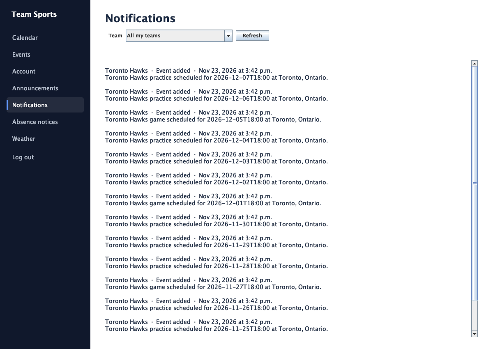
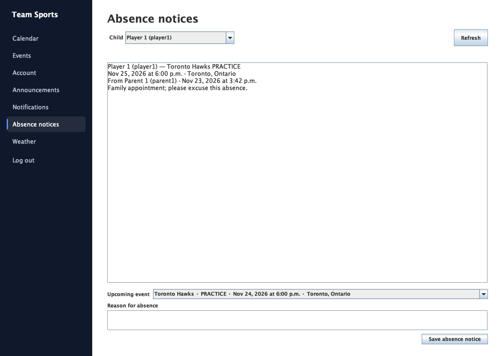
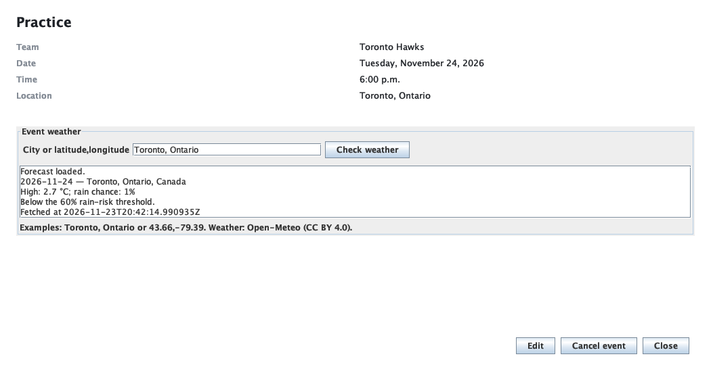

# Team Sports

## Summary

Team Sports is a desktop application that brings everything a sports team needs into one shared space: schedules, announcements, attendance, performance stats, and roster information. Coaches can plan and publish practices and games with dates, times, and locations, record attendance and player stats after each one, and send updates to the whole team. Players can view their upcoming commitments, RSVP so the coach knows who is attending, and track their own attendance and progress over the season. Parents can follow their child's schedule and submit absence notices ahead of time, so nothing is missed. By supporting multiple sports and multiple roles within a single unified interface, the platform replaces scattered group chats, spreadsheets, and paper sign-ups with one organized place for the whole team.

*Refer to (`Proposal.md`) for a more detailed description*

## User stories

| # | User story | Owner |
|---|-----------|-------|
| 1 | As a coach, I want to create and schedule practices and games (date, time, location) so that my team always knows when and where to show up all in one platform. | Alan (L1) |
| 2 | As a coach, I want to record player attendance and performance stats after each practice or game so that I can track player development over the season. | Aidan (L2) |
| 3 | As a player, I want to view my team's upcoming schedule and RSVP to practices and games so that my coach knows whether I'll be attending. | Alan + Aidan (L1/L2) |
| 4 | As a player, I want to view my personal stats and attendance history so that I can monitor my own progress. | Aidan (L2) |
| 5 | As a parent, I want to receive notifications when events are added, changed, or cancelled so that I can stay informed about my child's commitments. | Daniel (L5) |
| 6 | As a parent, I want to view my child's schedule and submit absence notices so that the coach is informed ahead of time. | Aarav + Daniel (L4/L5) |
| 7 | As an admin, I want to create teams and assign coaches and players to them so that the platform's rosters stay organized and up to date. | Aarav (L4) |
| 8 | As an admin, I want to manage user accounts and roles (coach, player, parent) so that each user only has access to the features appropriate to them. | Andy (L3) |

The individual use cases behind each story are catalogued in `Plan.md`.

## APIs

### Open-Meteo — weather forecast

Event details offers **Check weather** for a city such as `Toronto, Ontario` or a coordinate pair such as `43.66,-79.39`. The Weather page offers **Check rain risk** for upcoming events, then adds measured rain-risk flags to the calendar and events list. Requests run in background workers after these explicit actions. Forecasts cover today through the following 15 days. Rain probability of at least 60% produces a flag, while missing or invalid values produce an unavailable state. City forecasts describe the selected city, so they may differ from conditions at a particular arena.

The gateway reuses forecasts for 15 minutes and can show clearly labelled stale data up to 24 hours old after a request fails. The cache lasts for the current application process. Opening an event only loads its metadata until **Check weather** is pressed.

Java API calls succeeded on October 29 and November 23, 2026. The November 23 live test returned Toronto's daily high of 10.0 °C and rain probability of 20%. The actual event-weather panel also resolved Toronto, Ontario, Canada for a November 24 event and displayed a high of 2.7 °C and rain probability of 1%. To repeat a live check, run `./gradlew test -Pnetwork`. The normal test suite excludes network-tagged tests. The educational, noncommercial app uses the public service without an API key or a paid service configuration. Weather data is attributed to Open-Meteo under CC BY 4.0. [Forecast documentation](https://open-meteo.com/en/docs), [geocoding documentation](https://open-meteo.com/en/docs/geocoding-api), [terms and attribution](https://open-meteo.com/en/terms).

### Supabase (Postgres + REST) — the shared database (in use)
- **Documentation:** https://supabase.com/docs/guides/api
- **How it is used:** accounts, teams, events, attendance and announcements live in a Supabase Postgres database and are read and written through its REST API (PostgREST): a read filters on the key, and a save posts to `?on_conflict=<key>` with `Prefer: resolution=merge-duplicates`. Code: `data_access/SupabaseAppDataAccessObject`; schema in `db/schema.sql`; setup in `db/README.md`. The connection comes from the in-app **Database settings** page (stored in `%USERPROFILE%\.team-sports\database.properties`) or from `TEAMSPORTS_DB_URL` / `TEAMSPORTS_DB_KEY`. Only the **publishable** key is used - a secret key bypasses row level security and the app refuses one.
- **Called successfully?** **Yes.** First verified against the project on 2026-11-23: all five tables answered `200 []`, and `/rest/v1/` answered `401 Secret API key required`, which is the healthy answer for that route and proves PostgREST is reachable. Live check: `gradlew test -Pnetwork`.

### Ideas we have not called yet
- **TheSportsDB** — https://www.thesportsdb.com/free_sports_api — link a team to a real pro team and import names or photos (free test key).
- **Nominatim (OpenStreetMap)** — https://nominatim.org/release-docs/latest/api/Overview/ — turn a typed venue address into coordinates.
- **Nager.Date** — https://date.nager.at/swagger/index.html — warn when a practice lands on a holiday or long weekend.
- **API-Ninjas (Exercises)** — https://api-ninjas.com/api/exercises — drill suggestions for practice plans (free key in a header).

### Where data lives
- **Shared:** accounts, teams, events, attendance, announcements, event-change notifications, parent links and absence notices live in the Supabase database above, so every device that connects with the same project sees the same data.
- **Local fallback:** with no database configured the app uses `data/app-data.json` (git-ignored), which is also what the unit tests use. Each machine has its own copy. The sign-in page always shows which store is active.
- **Connection settings are per user and per machine**, outside the repository: `%USERPROFILE%\.team-sports\database.properties` on Windows, `~/.team-sports/database.properties` on macOS and Linux.
- **If a store is not usable the app says so.** A database that cannot be reached leaves the app on the sign-in page with the reason instead of switching to the local file, and a `data/app-data.json` that cannot be loaded is kept beside the new file as `app-data.json.corrupt-<timestamp>` while the app starts empty.
- **Passwords are stored hashed.** Keep real credentials out of this application anyway, and keep runtime JSON files out of commits.

### Demo data only

**Put only demo data in the shared database. Do not enter real people's names or details, or a password used anywhere else.** The app checks each user's role itself, but the database does not yet enforce those permissions. Anyone with the project URL and publishable key can bypass the app to read, add and change stored rows, including password hashes and account roles. The demo administrator `admin1` has a published password, so change it or deactivate the account if other people can reach the project. This restriction stays until the database enforces permissions for signed-in users.

## Current features and ownership

The L5 features below are implemented on `daniel/l5-completion` and await teammate review. PR #10 supplies the integrated scheduling foundation.

| Feature | Owner | Current behavior |
|---|---|---|
| Accounts | Andy (L3) | Signup, login, logout, password changes, and the administrator's **Manage Users** page: create, re-role, deactivate and reactivate accounts |
| Scheduling | Alan (L1) | Stored calendar and event list, event details, coach edits/cancellations, and `.ics` export |
| Announcements | Daniel (L5) | Coaches post to assigned teams. Players, coaches, admins, and linked parents read authorized team posts |
| Event notifications | Daniel (L5) | Created, changed, and cancelled event history persists with the event transaction and is filtered to authorized teams |
| Parent absence notices | Daniel (L5) | Linked parents submit or update a reason for an upcoming event. Coaches read notices for their teams |
| Parent links | Aarav's L4 dependency, implemented here for the requested parent features | Admins link and unlink existing parent/player accounts. Links also authorize parent calendar, announcement, and notification reads |
| Weather | Daniel (L5) | On-demand event forecasts, cache/error states, and upcoming-event rain flags |
| Attendance, RSVP, history, stats | Aidan (L2) | Work remains on a separate branch under review |
| Roster management | Aarav (L4) | Work remains on a separate branch under review |

## Delivery checks — November 23, 2026

On `daniel/l5-completion`, before it was combined with the hosted store and Manage Users, `./gradlew --offline build installDist` passed all 297 offline tests and built the runnable distribution, and `./gradlew --offline test -Pnetwork` passed all 298 tests including the live weather check. The actual `Main.configure` application path was exercised through the forms, and the screenshots below were captured from Swing pages with a live event forecast. Teammate review remains pending for `daniel/l5-completion`.

After combining it with the hosted store and Manage Users, `./gradlew --offline build` passes 528 tests in 65 classes. The installed application is in `build/install/team-sports-platform`, and the ZIP distribution is `build/distributions/team-sports-platform-0.1.0.zip`. These are local build outputs. Detailed evidence and independent branch findings are in `Documentation.md`.

## How to run

Use JDK 21 and the checked-in Gradle wrapper (JDK 17 or newer works; `JAVA_HOME` must point at it). The project targets Java 17 bytecode. The first build downloads dependencies when they are absent from the local cache.

```bash
./gradlew build
./gradlew test              # unit tests (network tests are skipped, so this works offline)
./gradlew test -Pnetwork    # also runs the live Open-Meteo and database checks
./gradlew run
```

On Windows, use `gradlew.bat`. With cached dependencies, `./gradlew --offline build` verifies the application without dependency downloads.

Each role sees only the pages it may use, an administrator creates, re-roles, deactivates and reactivates accounts on **Manage Users**, and **Create an Account** makes a new one - a username of 3 to 40 characters and a password of 8 to 128, the same rule on every page that writes a credential.

To use the shared database, open **Database settings** on the sign-in page and paste the project URL and publishable key (see `db/README.md`) - nothing is needed in a terminal. Without it the app keeps its data in `data/app-data.json`, which is git-ignored.

A genuinely empty local store receives the presentation dataset on startup, and existing stores keep their data. A shared database is only given the four demo accounts `coach1` (coach), `player1` (player), `parent1` (parent) and `admin1` (admin), password `teampass`, stored hashed, plus a team, because it is shared with other people. They are created only while the store has no account of its own, so a demo account an administrator deleted stays deleted. To create a separate local demo, choose a destination that does not already exist and use the same path to run it.

```bash
./gradlew seedDemo -PdemoData=data/demo-data.json
./gradlew run -PappData=data/demo-data.json
```

`seedDemo` refuses an existing destination. The dataset contains `admin1`, `coach1`–`coach2`, `player1`–`player8`, and `parent1`–`parent4`, all with password `pw`. That is shorter than the password rule allows, so these accounts are stored and checked as given and sign-in does not re-hash them; keep the file local. It includes three teams, 42 events over the next 14 days, eight parent/player links, announcements, notification history, and an absence notice. Keep the demo file local. The five-minute presentation script and verification instructions are in [Documentation.md](Documentation.md#10-five-minute-demo).

## Screenshots

The L5 pages show event changes, parent absence reporting, and on-demand forecasts.







The earlier screenshots below show the team's initial interface.


